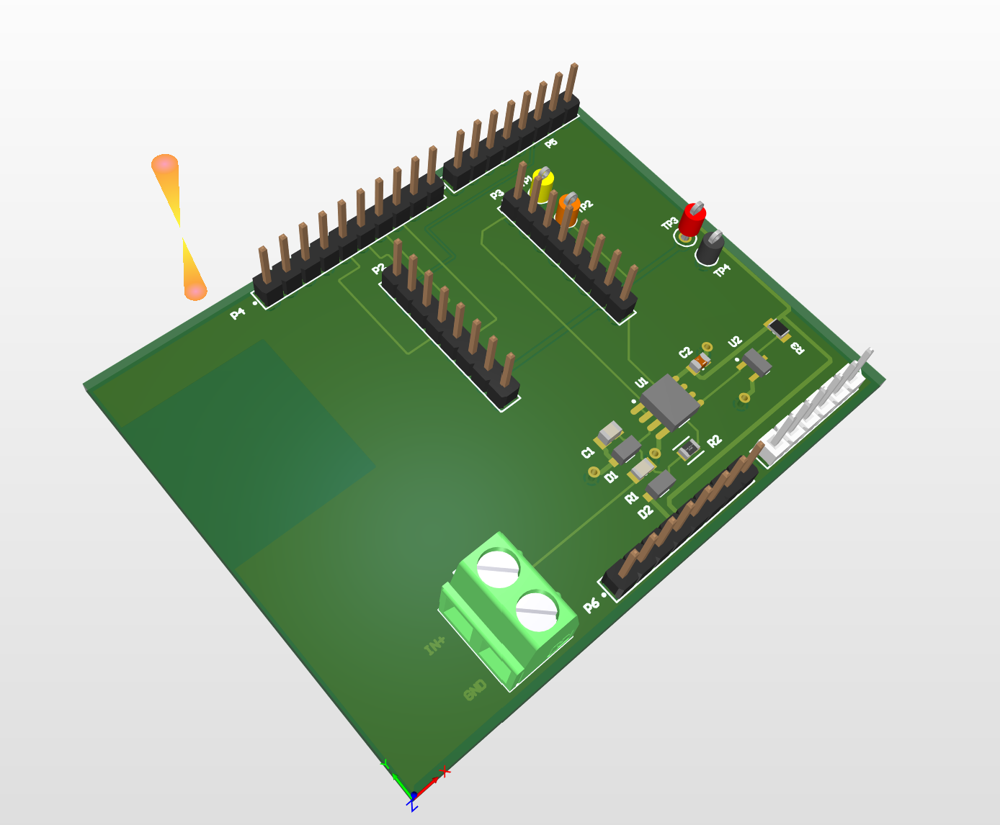
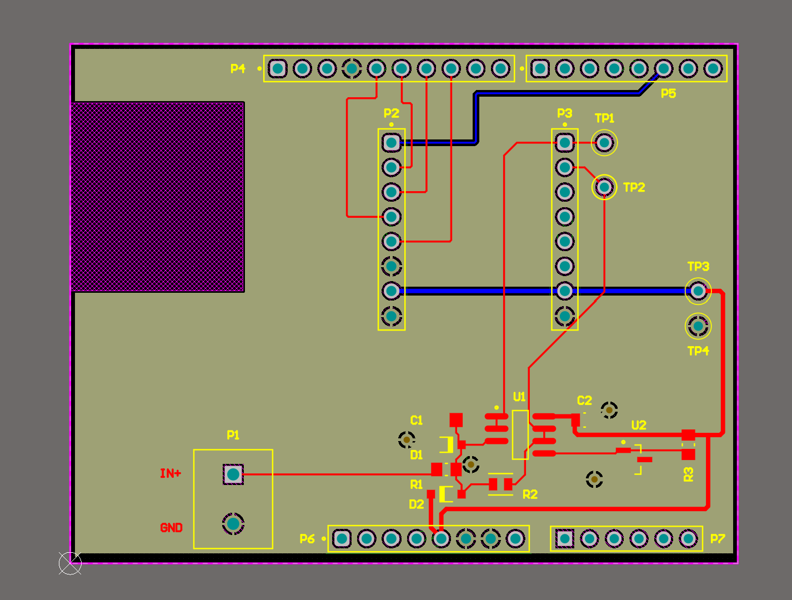
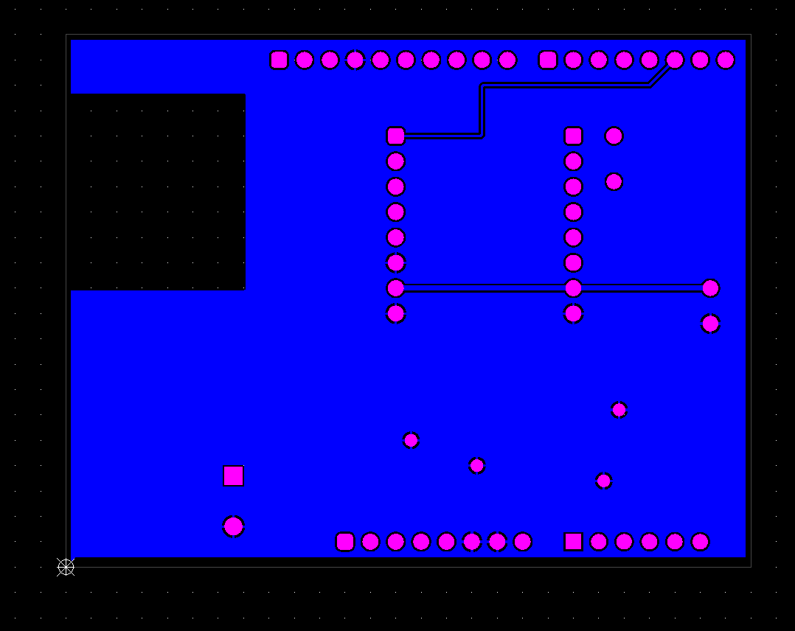

# USB-Voltmeter – 24-Bit-DC-Spannungsmesser als Arduino-Shield
 
Ein selbst entwickeltes Präzisions-Spannungsmessgerät (±10 V DC) auf Basis des
24-Bit-Delta-Sigma-ADC **ADS1220**, aufgebaut als Shield für den Arduino Uno und
per **SCPI** über USB steuerbar – wie ein Labormessgerät.
 
Das Projekt deckt die komplette Entwicklungskette ab:
**Spezifikation → Simulation (LTspice) → Schaltplan & Layout (Altium) → Fertigung (JLCPCB)
→ Firmware → Kalibrierung & messtechnische Verifikation (Python/SCPI).**
 
> Status: 🟡 Platine in Fertigung – Firmware und Messungen in Arbeit
 

 
---
 
## Spezifikation
 
| Parameter | Wert |
|---|---|
| Messbereich | ±10 V DC |
| Eingangswiderstand | 11 MΩ |
| ADC | TI ADS1220, 24 Bit, Delta-Sigma, interne Referenz 2,048 V |
| Netzbrummunterdrückung | 50/60 Hz simultan (Digitalfilter des ADS1220, 20 SPS) |
| Überspannungsschutz | Klemmdioden + strombegrenzender Eingangswiderstand |
| Schnittstelle | USB (virtueller COM-Port), SCPI-Befehle |
| Plattform | Arduino Uno R3 (Shield) |
 
## Schaltungskonzept
 
```
IN ──R1 10M──┬── NODE ──[U1A Puffer]── OUT ──► ADS1220 AIN0
             │                                    (differentiell)
           R2 1M   C1 10n   D1/D2 (Klemmung)
             │                                    
REF ◄──[U1B Puffer]── REF_RAW ◄── LM4040 2,5 V ──► ADS1220 AIN1
```
 
- **Teiler mit Fußpunkt an 2,5 V:** Bipolare Eingangsspannungen werden auf den
  Bereich 0…5 V der Einzelversorgung abgebildet.
  $V_\text{node} = V_\text{ref} + \frac{V_\text{in}-V_\text{ref}}{11}$
- **Differentielle Messung** zwischen OUT und REF:
  $V_\text{in} = 11 \cdot V_\text{diff} + V_\text{ref}$
- **CMOS-Puffer (MCP6002)** mit pA-Eingangsruhestrom, da der Knoten ≈ 0,91 MΩ
  Innenwiderstand hat.
- **RC-Tiefpass** aus Teiler-Innenwiderstand und C1 (C0G), f_g ≈ 17,5 Hz.
- **Kalibrierung:** $V_\text{kal} = a \cdot V_\text{roh} + b$ (Verstärkungs- und Offsetfehler).
## Simulation (LTspice)
 
Jede Stufe wurde einzeln simuliert und mit einer Handrechnung verglichen:
 
| Untersuchung | Ergebnis |
|---|---|
| DC-Übertragung des Teilers | ✅ wie berechnet |
| Einfluss Op-Amp-Eingangswiderstand (500 MΩ vs. 1 TΩ) | Verstärkungsfehler ±20 mV → ±50 µV |
| Einfluss Eingangsruhestrom (1 nA vs. 1 pA) | Offset 9 mV → 9 µV |
| Frequenzgang Filter | f_g = 17,66 Hz (berechnet 17,7 Hz) |
| Überspannung 30 V / 60 V | Knoten auf ≈ 5,2 / 5,3 V geklemmt, Diodenstrom ≈ 0,1 / 3 µA |
| Monte-Carlo, 0,1 %-Widerstände | Verstärkungsfehler bis ≈ 0,14 % → Kalibrierung nötig |
 
**Erkenntnis:** Das Fehlerbudget wird von Bauteiltoleranzen (mV-Bereich) dominiert,
nicht von der Schaltungstopologie (µV-Bereich).
 
> Hinweis: Simuliert wurde mit R1 = 9 MΩ (Teiler 1:10). Gefertigt wird mit R1 = 10 MΩ
> (Teiler 1:11, Eingangswiderstand 11 MΩ), weil 9,1 MΩ in 0805 nicht lieferbar war.
> Die Fehlermechanismen und Größenordnungen bleiben gleich.
 
Dateien und Plots: [`simulation/`](simulation/)
 
## Hardware
 
- Schaltplan: [`hardware/USB-Voltmeter_Schematic.pdf`](hardware/USB-Voltmeter_Schematic.pdf)
- Layout: 2 Lagen, 68,6 × 53,3 mm, durchgehende GND-Fläche auf der Unterseite,
  Sperrfläche über der USB-Buchse des Uno
- Stückliste: [`hardware/BOM.csv`](hardware/BOM.csv)
- Fertigungsdaten (Gerber/Drill für JLCPCB): [`hardware/fabrication/`](hardware/fabrication/)
- Passvorlage 1:1 zur mechanischen Prüfung auf dem Uno: [`hardware/fabrication/`](hardware/fabrication/)
| Oberseite | Unterseite |
|---|---|
|  |  |
 
## Firmware
 
TODO – ADS1220-Ansteuerung, SCPI-Parser (`*IDN?`, `MEAS:VOLT:DC?`)
 
## Messergebnisse
 
TODO – Kalibrierung, Linearität, Rauschen/effektive Auflösung, Vergleich mit Simulation
 
## Repository-Struktur
 
```
├── docs/            Konzept, Herleitungen, Bilder
├── simulation/      LTspice-Dateien (.asc) und Plots
├── hardware/        Altium-Projekt, Schaltplan-PDF, BOM, Gerber
├── firmware/        Arduino-Sketch
├── scripts/         Python: SCPI-Steuerung, Kalibrierung, Auswertung
└── measurements/    Rohdaten (.csv) und Auswertungen
```
 
## Autor
 
Amirsadra Shahanjarini – M.Sc. Elektrotechnik, TU München
 
