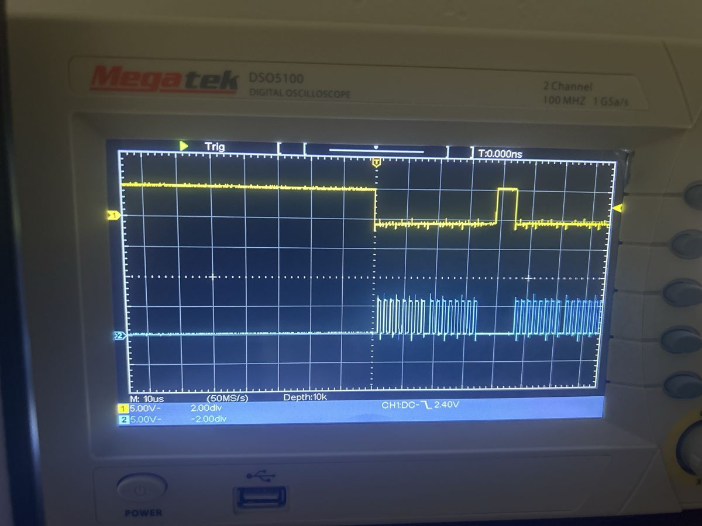
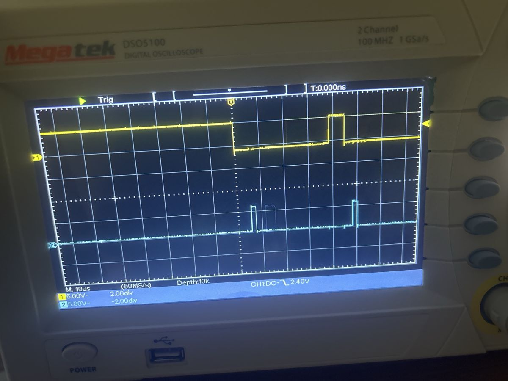
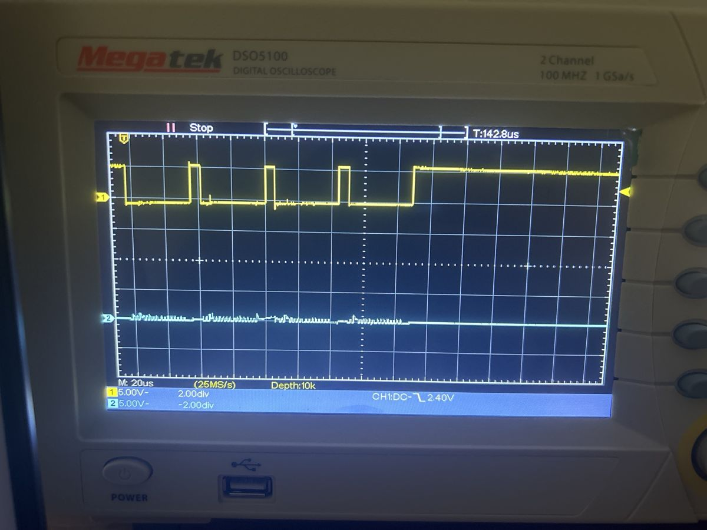
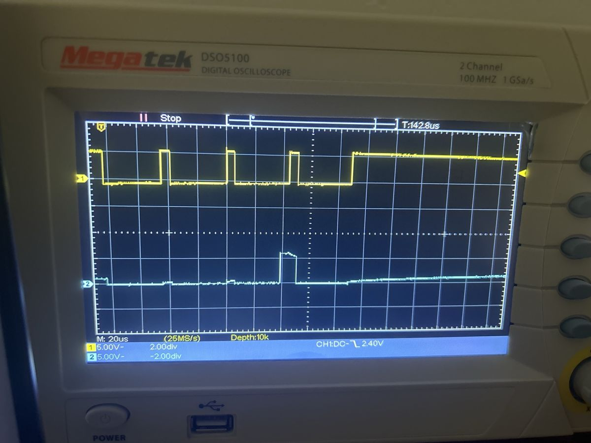

# Breadboard-Test des ADS1220-Moduls

Bevor die Platine bestückt wird, wurde das ADS1220-Modul einzeln auf dem Breadboard
mit dem Arduino Uno in Betrieb genommen. Ziel: SPI-Kommunikation prüfen, das
Eigenrauschen des ADC messen und die Umrechnung in mV verifizieren.

**Ergebnis:** Der ADC erreicht mit kurzgeschlossenem Eingang **3,5 µVrms**
Rauschen. Das entspricht dem Datenblattwert (3,89 µVrms) und ergibt
**≈ 19 Bit effektive Auflösung**. Auf dem Weg dorthin musste ein Kontaktfehler auf
der MISO-Leitung mit dem Oszilloskop eingegrenzt werden.

---

## Aufbau

| ADS1220-Modul | Arduino Uno | Funktion |
|---|---|---|
| CS | D10 | Chip Select |
| DIN (MOSI) | D11 | Daten Uno → ADC |
| DOUT (MISO) | D12 | Daten ADC → Uno |
| SCLK | D13 | SPI-Takt |
| DRDY | D2 | Data Ready |
| AVDD, DVDD | 5V | Versorgung (über USB) |
| AGND, DGND | GND | Masse |

- **Messeingang:** AIN0 gegen AVSS (single-ended), PGA aus, Gain 1, interne Referenz
  2,048 V, 20 SPS, simultane 50/60-Hz-Unterdrückung
- **Quelle:** Labornetzteil SPE3051 (Strombegrenzung 10 mA), Vergleich mit Multimeter VC97
- **Firmware:** [`firmware/ads1220_test`](../firmware/ads1220_test) (Library `ADS1220_WE`),
  [`firmware/spi_diagnose`](../firmware/spi_diagnose) (SPI ohne Library)

---

## Fehlersuche: ADC antwortet nicht

**Symptom:** `ads.init()` schlägt fehl. Der Diagnose-Sketch schreibt `0x01` in
Register 0 und liest danach trotzdem `0x00` zurück, bei zwei verschiedenen Modulen.

Versorgung (5 V an AVDD/DVDD) und Durchgang der Leitungen waren in Ordnung. Deshalb
wurde die SPI-Strecke mit dem Oszilloskop (Megatek DSO-5100) Signal für Signal verfolgt.
Der Diagnose-Sketch läuft dafür in einer Schleife (500 kHz, SPI-Mode 1).

**Einstellungen:** CH1 an CS (D10) als Trigger, fallende Flanke bei 2,4 V,
5 V/div. CH2 wechselt zwischen den anderen Leitungen.

### 1. Am Uno: CS, SCLK, MOSI

| SCLK (D13) | MOSI (D11) |
|---|---|
|  |  |
| Zwei Befehle mit je 16 Takten (2 Byte), 2 µs pro Bit ✔ | Erstes Byte `0010 0000` = **0x20** (RREG Reg. 0), zweites `0100 0000` = **0x40** (WREG Reg. 0) ✔ |

Der Uno sendet also die richtigen Befehle. Dieselben Signale kamen auch an den
Chip-Pins 1 (SCLK), 2 (CS) und 16 (DIN) unverändert an.

### 2. Rückweg: DOUT am Chip vs. D12 am Uno

Zeitbasis 20 µs/div, Triggerpunkt an den linken Rand: Alle vier Befehle eines
Durchlaufs (Lesen, Schreiben 0x01, Lesen, Zurücksetzen) sind sichtbar.

| D12 am Uno | DOUT direkt am Chip (Pin 15) |
|---|---|
|  |  |
| Nur kleine Spikes im SCLK-Takt: Übersprechen auf eine **offene Leitung** ✘ | Im dritten Befehl ein 5-V-Puls im letzten Bit = **0x01** zurückgelesen ✔ |

**Diagnose:** Der ADS1220 arbeitet korrekt und antwortet. Die Antwort geht zwischen
Modul und Uno verloren. Weil beide Module gleich ausfielen, lag der Fehler im
gemeinsamen Aufbau und nicht im Chip.

**Ursache:** Die Stiftleiste war schief eingelötet. Das Modul saß dadurch einseitig
zu hoch im Breadboard, und der MISO-Pin hatte keinen Kontakt zur Federleiste.
Mit dem Modul angedrückt lief alles sofort.

**Behebung:** Plastikleiste der Stiftleiste abgezogen. Dann jeden Pin einzeln
nachgelötet, mit dem Breadboard als Lehre, sodass die Pins senkrecht stehen.

---

## Messergebnisse

Jede Zeile im seriellen Monitor enthält Mittelwert und Standardabweichung aus 20
Einzelwerten (≈ 1 s). Rohdaten: [`measurements/2026-11-01_breadboard.csv`](../measurements/2026-11-01_breadboard.csv)

| Eingang | Mittelwert | Rauschen σ (Einzelwert) | Datenblatt |
|---|---|---|---|
| Draht AIN0 → GND | −0,318 mV | **3,5 µVrms** | 3,89 µVrms, Offset ±4 µV (typ.) |
| Netzteil auf 0,000 V | −2,06 mV | 28 µVrms | – |
| Netzteil auf 0,500 V | 499,94 mV (VC97: 500 mV) | 24 µVrms | – |
| Netzteil auf 1,800 V | 1802,03 mV | 25 µVrms | – |

### Effektive Auflösung

Mit dem Rauschen bei kurzgeschlossenem Eingang und dem Messbereich 2,048 V:

$$\text{ENOB}_\text{rms} = \log_2\frac{2{,}048\ \text{V}}{3{,}5\ \mu\text{V}} \approx 19{,}2\ \text{Bit}
\qquad
\text{rauschfrei } (6{,}6\,\sigma) = \log_2\frac{2{,}048\ \text{V}}{23\ \mu\text{V}} \approx 16{,}5\ \text{Bit}$$

Die 24 Bit sind die Wortbreite des ADC. Nutzbar sind real ≈ 19 Bit, was bei einem
Delta-Sigma-Wandler mit 20 SPS dem erwarteten Wert entspricht.

### Erkenntnisse

1. **Der ADC selbst arbeitet auf Datenblattniveau.** Das Rauschen bei kurzgeschlossenem
   Eingang stimmt mit dem Datenblatt überein.
2. **Mit Netzteil am Eingang steigt das Rauschen um den Faktor ≈ 8** (3,5 → 25 µV), und
   bei 0 V entsteht ein Offset von ≈ −2 mV. Das liegt nicht am ADC, sondern an der
   Quelle: Restfehler und Rauschen des Netzteils und vermutlich eine Masseschleife
   über Netzteil und PC/USB.
3. **Single-ended gegen Masse ist empfindlich gegen alles auf der Masseleitung.** Genau
   deshalb misst die Platine **differenziell (OUT − REF)** über einer durchgehenden
   GND-Fläche.
4. **Der verbleibende Offset (−0,32 mV) ist konstant (±2 µV)** und wird später über die
   Kalibrierung $V_\text{kal} = a\,V_\text{roh} + b$ korrigiert.
5. **Das Multimeter VC97 ist als Referenz zu ungenau** (1 mV Auflösung, ≈ 0,5 %). Der
   Vergleich bei 0,5 V bestätigt nur, dass Umrechnung und Referenz grob stimmen.
   Die eigentliche Kalibrierung erfolgt auf der fertigen Platine mit einem 5½- oder
   6½-stelligen Tischmultimeter.

### Nebenbefund: Float-Auslöschung auf dem Uno

Die erste Firmware berechnete die Varianz als $\overline{v^2} - \bar v^2$. Auf dem Uno
ist `double` nur ein 32-Bit-`float` (≈ 7 Stellen). Bei 1,8 V ist
$\overline{v^2} \approx 3{,}2\cdot10^6\ \text{mV}^2$, und die Differenz zweier fast
gleicher Zahlen verliert alle signifikanten Stellen. σ sprang deshalb nur zwischen
0, 500, 707 und 866 µV. Die korrigierte Firmware bildet zuerst den Mittelwert und
summiert dann die quadrierten Abweichungen davon.
