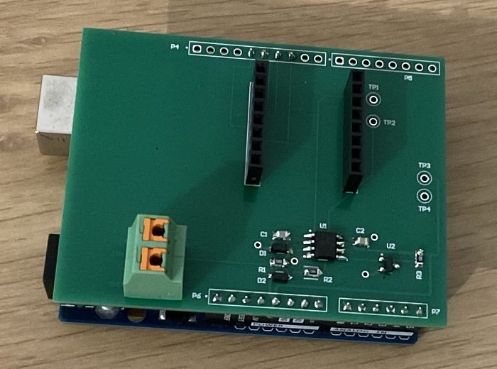
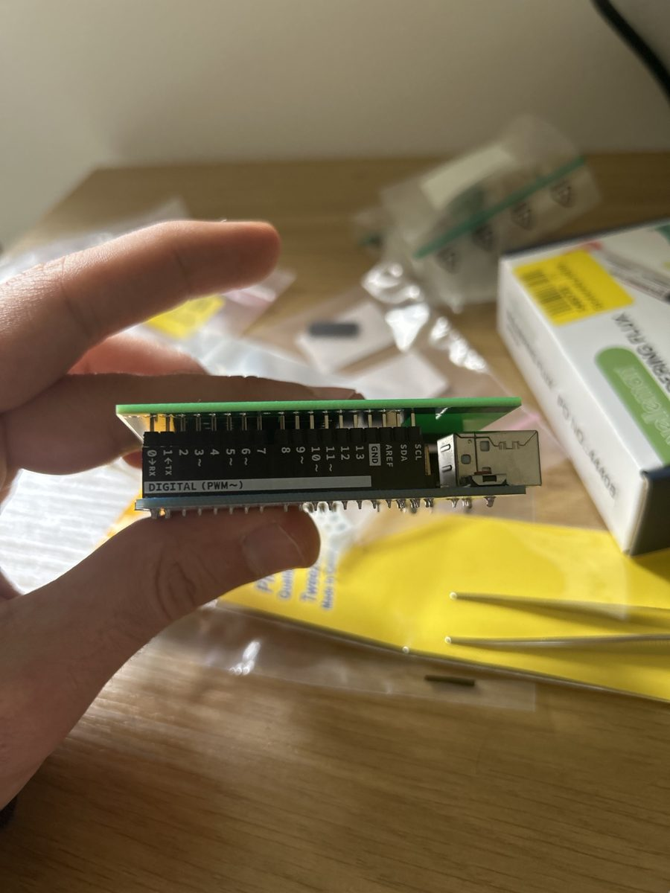
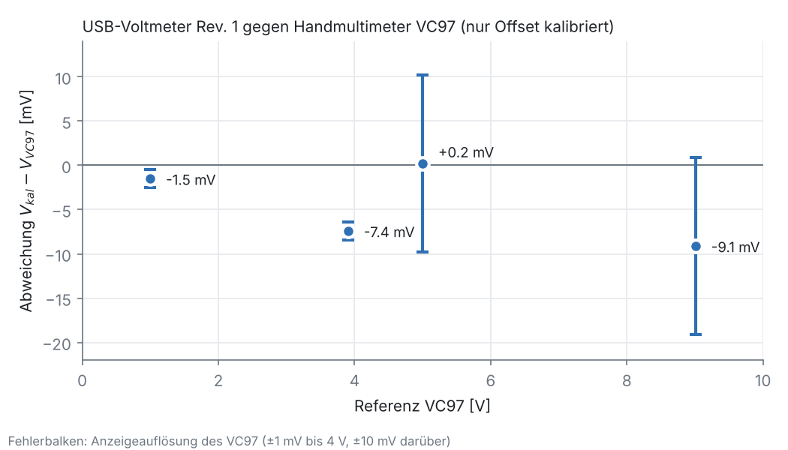

# Inbetriebnahme Platine Rev. 1

**Ergebnis:** Rev. 1 misst nach vier behobenen Fehlern und einem Workaround für einen
Layoutfehler im gesamten getesteten Bereich (0 bis 9 V) innerhalb weniger mV des
Referenzmultimeters. Das Rauschen liegt bei **≈ 80 µVrms** am Eingang
(Einzelwandlung, 20 SPS). Bezogen auf den Messbereich ±10 V sind das
**≈ 18 Bit effektive Auflösung**.

---

## Erratum: Digitalheader P4/P5 um 100 mil versetzt

Bei der Passprobe passten P6/P7 (Power/Analog) auf den Uno, P4/P5 (Digital) nicht.
Der Abgleich der Bohrdatei mit der Referenz-Footprint des Uno R3 zeigt: Die gesamte
Digitalreihe liegt **100 mil (1 Pin) zu weit von der USB-Buchse entfernt**.

| | Rev. 1 (Bohrdatei) | Uno R3 |
|---|---|---|
| Power Pin 1 / A0 | 1100 / 2000 mil | 1100 / 2000 mil ✔ |
| SCL (P4 Pin 1) | 840 mil | 740 mil ✘ |
| D7 (P5 Pin 1) | 1900 mil | 1800 mil ✘ |

**Workaround ohne Neubestellung:** Die Löcher liegen weiterhin im 2,54-mm-Raster,
jedes Signal landet also auf dem Nachbar-Pin des Uno. Hardware-SPI (D11–D13) ist so
nicht nutzbar, daher:

| Netz auf der Platine | landet auf | Lösung |
|---|---|---|
| SCLK, MISO, MOSI, CS (P4 Pin 5–8) | D12, D11, D10, D9 | **Software-SPI** auf diesen Pins |
| GND (P4 Pin 4) | D13 | Pin nicht bestückt (GND kommt über P6) |
| DRDY (P5 Pin 6) | D1 / TX | P5 nicht bestückt, Single-Shot mit fester Wartezeit |

P4 ist deshalb nur mit Pin 5–8 bestückt, P5 gar nicht. Firmware:
[`firmware/voltmeter_rev1`](../firmware/voltmeter_rev1).
**Für Rev. 2:** P4 und P5 um −100 mil in X verschieben.

---

## Fehlersuche bei der Inbetriebnahme

Vorgehen: erst ohne ADC-Modul die Analogstufe über die Testpunkte prüfen, dann das
Modul einsetzen.

| # | Symptom | Diagnose | Ursache | Behebung |
|---|---|---|---|---|
| 1 | TP2 (REF) = 4,3 V statt 2,50 V | U1 Pin 5 (REF_RAW) = 2,5 V ✔, U1 Pin 7 = 5 V. Pin 7 und die Leiterbahn darunter haben unterschiedliche Spannung | Lötstelle an U1B (Pin 6/7): Rückkopplung offen, Puffer läuft in die Sättigung | Nachgelötet → TP2 = **2,507 V** |
| 2 | TP1 (OUT) = 4,68 V bei offenem Eingang | NODE liegt knapp eine Diodenspannung unter +5 V | Fehler an D2/R2 im Eingangsteiler | Behoben → TP1 = **2,509 V** offen, **2,281 V** mit Eingang auf GND (erwartet 2,279 V) |
| 3 | ADC liest −1,2 … −2 V statt −0,23 V bzw. 0 V | TP1/TP2 korrekt, am Modul-Pin AIN0 aber nur 0,2–0,6 V (schwankend) | AIN0 ohne Kontakt zwischen P3 und Modul → Eingang offen | Kontakt hergestellt → V_diff = **−226,4 mV** (erwartet −227 mV) |
| 4 | – | – | – | PGA eingeschaltet (Gain 1): Der ADC puffert seine Eingänge selbst, die Op-Amps sehen keine Abtastströme |

Prüfwerte der Analogstufe (gegen TP4, ohne Modul):

| Messpunkt | erwartet | gemessen |
|---|---|---|
| TP2 (REF) | 2,500 V ± 1 % (LM4040, D-Version) | 2,507 V |
| TP1, Eingang offen | = REF | 2,509 V |
| TP1, Eingang auf GND | $2{,}507 \cdot \tfrac{10}{11} = 2{,}279$ V | 2,281 V |

---

## Messergebnisse

Quelle: Labornetzteil an P1. Referenz: Handmultimeter VC97 parallel an P1.
Rohdaten: [`measurements/2026-11-13_rev1_kennlinie.csv`](../measurements/2026-11-13_rev1_kennlinie.csv)

### Offset-Kalibrierung

Mit kurzgeschlossenem Eingang zeigt das Gerät $V_\text{roh} = 17{,}1$ mV. Ursache sind
die Toleranzen des 1-%-Teilers, die Abweichung der Referenz und die Op-Amp-Offsets.
Korrigiert wird mit

$$V_\text{kal} = a \cdot V_\text{roh} + b, \qquad b = -17{,}1\ \text{mV}, \quad a = 1$$

Der Kurzschluss ist selbst die Referenz für $b$, dafür ist kein externes Messgerät nötig.

### Vergleich mit dem VC97

| Netzteil | V_kal | VC97 | Abweichung |
|---|---|---|---|
| 1 V | 0,99851 V | 1,000 V | −1,5 mV (−0,15 %) |
| 3,9 V | 3,90056 V | 3,908 V | −7,4 mV (−0,19 %) |
| 5 V | 5,00017 V | 5,00 V | +0,2 mV (VC97 nur 10 mV Auflösung) |
| 9 V | 9,00093 V | 9,01 V | −9,1 mV (VC97 nur 10 mV Auflösung) |

Bei 1 V und 3,9 V, wo der VC97 noch 1 mV auflöst, liegt das Gerät gleichmäßig
**0,15–0,19 % unter dem VC97**. Das ist ein Verstärkungsunterschied zwischen den
beiden Geräten, keine Nichtlinearität. Er liegt aber innerhalb dessen, was ein
Handmultimeter an Unsicherheit mitbringt. Welches Gerät richtig liegt, lässt sich
mit dem VC97 nicht entscheiden. Deshalb bleibt **$a = 1$**, bis ein 5½- oder
6½-stelliges Tischmultimeter als Referenz verfügbar ist.

### Rauschen

Standardabweichung je 10 Einzelwandlungen, umgerechnet auf den Eingang (×11):
**≈ 80 µVrms** im ganzen Bereich von 0 bis 9 V.

$$\text{ENOB} = \log_2\frac{20\ \text{V}}{80\ \mu\text{V}} \approx 17{,}9\ \text{Bit} \quad (\text{Messbereich } \pm 10\ \text{V})$$

---

## Erkenntnisse

1. **Hochohmige Knoten reagieren auf Leckströme.** Bei offenem Eingang hängt NODE nur
   über R2 = 1 MΩ an REF, mit Quelle über R1‖R2 ≈ 0,9 MΩ. Schon 1 nA ergibt dort 1 mV,
   am Eingang ×11. Der Sperrstrom der 1N4148W (nA-Bereich, stark temperaturabhängig)
   und Flux-Reste reichen dafür. Der Offset wanderte entsprechend über Nacht um
   0,8 mV. → **Rev. 2: Low-Leakage-Klemmdioden** (z. B. BAV199, pA-Bereich) und
   gründliche Reinigung.
2. **Messpunkte im Layout haben sich gelohnt.** TP1/TP2 und die Vorgabe, ohne ADC-Modul
   zu starten, haben jeden Fehler auf eine Stufe eingegrenzt, bevor das Modul gefährdet war.
3. **Stecker und Buchsen sind die häufigste Fehlerquelle.** Wie schon beim
   [Breadboard-Test](breadboard-test.md) war ein Kontakt am Modul die Ursache für
   unsinnige Messwerte.
4. **Die Referenz begrenzt die Kalibrierung, nicht das Gerät.** Der VC97 löst über 4 V
   nur 10 mV auf. Die Verstärkungskalibrierung braucht ein besseres Referenzgerät.

## Offene Punkte

- [ ] Rev. 2: P4/P5 um −100 mil verschieben (dann Hardware-SPI und DRDY wieder nutzbar)
- [ ] Rev. 2: Low-Leakage-Klemmdioden
- [ ] Verstärkungskalibrierung $a$ mit Tischmultimeter, Messung negativer Spannungen
- [ ] SCPI-Befehle (`*IDN?`, `MEAS:VOLT:DC?`) und Python/PyVISA-Steuerung
