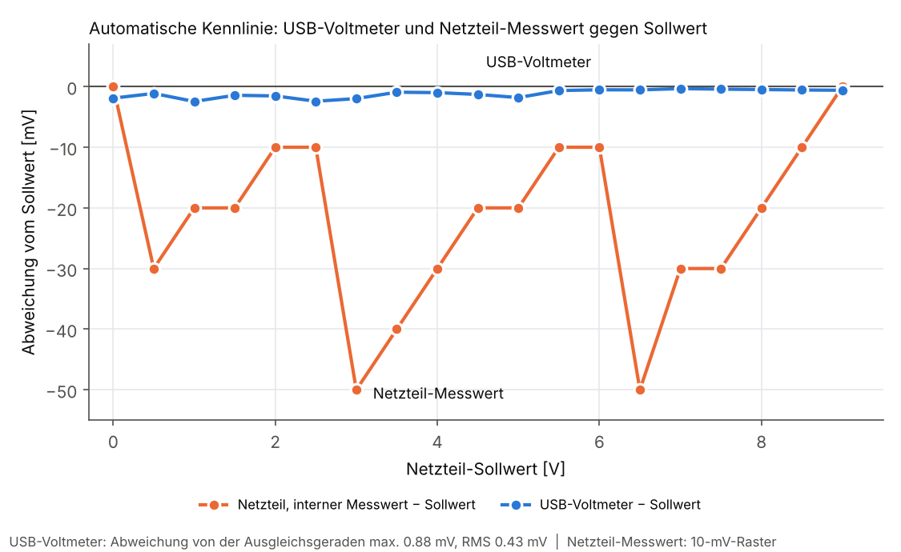

# SCPI-Schnittstelle und automatisierte Messung

Das USB-Voltmeter verhält sich wie ein Labormessgerät: Es misst nur auf Anfrage und
antwortet auf SCPI-Befehle über den virtuellen COM-Port des Arduino. Damit lässt es
sich zusammen mit anderen Laborgeräten aus Python (PyVISA) fernsteuern.

## SCPI-Befehle

Firmware: [`firmware/voltmeter_scpi`](../firmware/voltmeter_scpi).
115200 Baud, Befehle mit LF abschließen (CR wird ignoriert). Kurz- und Langform
sowie Groß-/Kleinschreibung sind beliebig (`MEAS:VOLT:DC?` = `measure:voltage:dc?`).

| Befehl | Funktion |
|---|---|
| `*IDN?` | `Shahanjarini,USB-Voltmeter,REV1,1.0` |
| `*RST` / `*CLS` / `*OPC?` | Grundeinstellung / Fehlerspeicher löschen / `1` |
| `*TST?` | Selbsttest: ADC-Register schreiben und zurücklesen, `0` = ok |
| `MEAS:VOLT:DC?` (auch `MEAS:VOLT?`, `READ?`) | Messung, kalibriert [V] |
| `MEAS:VOLT:DC:RAW?` | Messung, unkalibriert [V] |
| `CALC:SDEV?` | Standardabweichung der letzten Messung am Eingang [V] |
| `[SENS:]AVER:COUN <n>` / `?` | Wandlungen pro Messung, 1 … 100 (je ≈ 70 ms) |
| `CAL:OFFS <V>` / `?`, `CAL:GAIN <a>` / `?` | Kalibrierung $V_\text{kal} = a\,V_\text{roh} + b$ |
| `CAL:ZERO` | Offset bei kurzgeschlossenem Eingang automatisch bestimmen |
| `CAL:SAVE` | Kalibrierung dauerhaft im EEPROM speichern |
| `SYST:ERR?` | Fehlerspeicher, SCPI-Fehlercodes (`-113`, `-109`, `-222`, `-240` …) |

Die Firmware wurde vor dem ersten Einsatz am PC gegen einen simulierten ADS1220
getestet, der das SPI-Protokoll Bit für Bit nachbildet. Dabei fiel ein Fehler bei der
Vorzeichenerweiterung des 24-Bit-Ergebnisses auf, der auf dem AVR nicht sichtbar
gewesen wäre (dort ist `long` 32 Bit, auf dem PC 64 Bit).

## Automatisierte Kennlinie

Skript: [`scripts/kennlinie.py`](../scripts/kennlinie.py)

```
pip install pyvisa pyvisa-py pyserial numpy matplotlib
python kennlinie.py --list                                 # Ports und *IDN? anzeigen
python kennlinie.py --psu ASRL8::INSTR --dmm ASRL7::INSTR  # 0 … 9 V in 0,5-V-Schritten
```

Das Labornetzteil (OWON SPE3051) fährt eine Spannungsrampe, das Voltmeter misst an
jedem Punkt. Das Skript begrenzt die Spannung auf 10 V und den Strom auf 10 mA und
schaltet das Netzteil am Ende oder bei Abbruch immer auf 0 V und den Ausgang aus.
Ergebnis: CSV und Plot.

**Auswertung:** Durch die Messpunkte wird eine Gerade gelegt, die Restabweichung ist die
Nichtlinearität. Dafür muss das Netzteil nicht genau sein, nur linear.

### Ergebnis (13.11.2026)



Rohdaten: [`measurements/2026-11-13_kennlinie_auto.csv`](../measurements/2026-11-13_kennlinie_auto.csv)

| | Ergebnis |
|---|---|
| Nichtlinearität USB-Voltmeter (0 … 9 V, gegen Netzteil-Sollwert) | **max. 0,88 mV, RMS 0,43 mV** |
| Abweichung USB-Voltmeter vom Netzteil-Sollwert | −2,5 … −0,3 mV über den ganzen Bereich |
| Steigung gegenüber Netzteil-Sollwert | +0,019 % |

Die 0,88 mV sind eine **Obergrenze**: Sie enthalten auch die Nichtlinearität des
Netzteils selbst.

## Erkenntnisse

1. **Das Voltmeter ist genauer als die interne Messung des Netzteils.** Der erste
   Durchlauf nutzte den Netzteil-Messwert (`MEAS:VOLT?`) als Bezug und ergab scheinbar
   29 mV Nichtlinearität. Der Vergleich zeigt: Der Netzteil-Messwert hat nur ein
   10-mV-Raster und einen sägezahnförmigen Fehler bis −50 mV, während das Voltmeter
   dem Sollwert auf wenige mV folgt. Das Skript nutzt deshalb den **Sollwert** als Bezug
   (`--ref netzteil` wählt den Messwert).
2. **Störimpuls beim Einschalten des Netzteil-Ausgangs.** Beim Befehl `OUTP ON` brach
   die USB-Verbindung zum Uno ab. Windows meldete den COM-Port neu an, und die offene
   Verbindung blieb tot. Lösung im Skript: den Ausgang einschalten, *bevor* das
   Voltmeter verbunden wird, und bei Timeout den Port neu öffnen. Vermutete Ursache ist
   ein Ausgleichsstrom über die gemeinsame Masse (Netzteil-Minus → Messeingang → Uno →
   USB → PC), noch nicht abschließend geprüft.
3. **Arduino-Reset beim Öffnen des Ports.** Der Uno startet beim Öffnen des COM-Ports
   neu (DTR). Das Skript wartet danach 2,5 s, bevor es den ersten Befehl sendet.
